# TowerMind: LLM-Assisted Reinforcement Learning & Tower Defense Gym

<div align="center">

[](https://python.org)
[](https://gymnasium.farama.org)
[](https://pytorch.org)
[](https://github.com/astral-sh/ruff)
[](https://pytest.org)
[](LICENSE)

**A high-performance Gymnasium environment paired with a safe, two-timescale LLM meta-controller that guides Reinforcement Learning (PPO) in complex spatial tower defense scenarios.**

[Key Features](#-key-features) •
[System Architecture](#-system-architecture) •
[Quickstart](#-quickstart) •
[Interactive Dashboard](#-interactive-web-dashboard) •
[Curriculum & Maps](#-curriculum--generalization) •
[Benchmark Results](#-benchmark-results) •
[Project Structure](#-project-structure)

<br/>

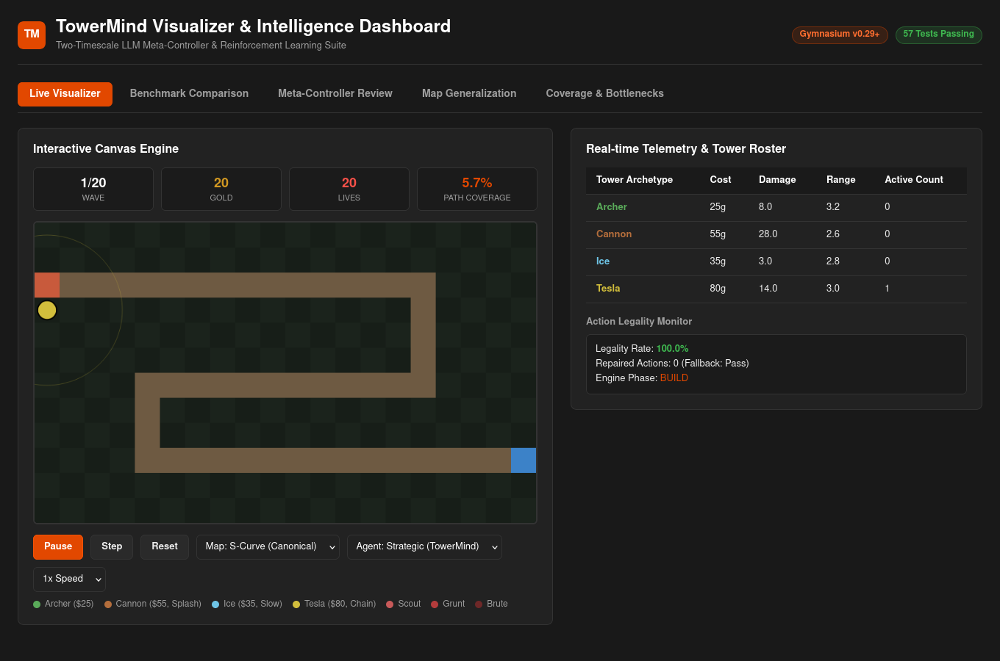

</div>

---

## Overview

**TowerMind** investigates human-in-the-loop and model-in-the-loop autonomous curriculum guidance. Traditional Reinforcement Learning (RL) agents often suffer from reward sparsity, action illegality, and reward shaping brittleness when learning spatial strategy games. 

TowerMind decouples the learning problem into two distinct timescales:
1. **Fast-Timescale Policy Learning**: A CleanRL-style spatial CNN Proximal Policy Optimization (PPO) agent interacts with a deterministic NumPy grid engine, learning low-level tower placement and real-time gold economy decisions.
2. **Slow-Timescale Meta-Controller**: At segmented training boundaries (e.g., every 256–512 timesteps), a safe LLM advisor reviews rolling performance telemetry, diagnoses behavioral bottlenecks (such as enemy leaks, hoarded gold, or poor path coverage), and formulates bounded reward profile adaptations.

To prevent policy collapse, every LLM suggestion passes through a strict safety envelope: schema validation, parameter bounding, and an empirical Promotion Gate evaluated on fixed-seed held-out rollouts.

---

##  Key Features

- ** Deterministic Engine**: Pure Python and NumPy simulation of projectile mechanics, splash damage, slow debuffs, creep waves, and dynamic BFS pathfinding.
- ** Gymnasium Interface**: Compliant with Farama Gymnasium standard (`TowerDefense-v0`), featuring multi-channel spatial grid observations `(C, H, W)` and global scalar metrics.
- ** Strict Action Legality Engine**: Authoritative joint spatial validation (`tower_type, y, x`) preventing illegal placements on paths, occupied tiles, or when gold is insufficient, paired with action masking and factorized sampling repair.
- ** Two-Timescale LLM Meta-Controller**: Safe LLM gateway supporting OpenAI, Anthropic, Gemini, Ollama, and deterministic offline mock providers with exponential retry backoff, token budgeting, and automatic fallback.
- ** Bounded Reward Profiles**: Versioned, immutable dataclass specifications ensuring LLM recommendations remain within safe numerical bounds.
- ** Empirical Promotion Gate**: Candidates are tested on matched validation rollouts. If a proposed reward profile causes performance regressions or illegal action spikes, the gate rejects the candidate and rolls back safely.
- ** Multi-Map Curriculum & Zero-Shot Generalization**: Five distinct spatial topologies (`s_curve`, `straight`, `zigzag`, `chokepoint`, `spiral`) across multiple difficulty tiers.
- ** Counterfactual Post-Episode Diagnostics**: Analyzes missed creep leaks, calculates optimal DPS chokepoints, and quantifies spatial coverage efficiency.
- ** Real-Time Web Dashboard & Canvas Visualizer**: Built-in HTTP telemetry server serving an interactive HTML5 60 FPS canvas game visualizer, benchmark comparisons, curriculum matrices, and counterfactual reports.

---

## System Architecture

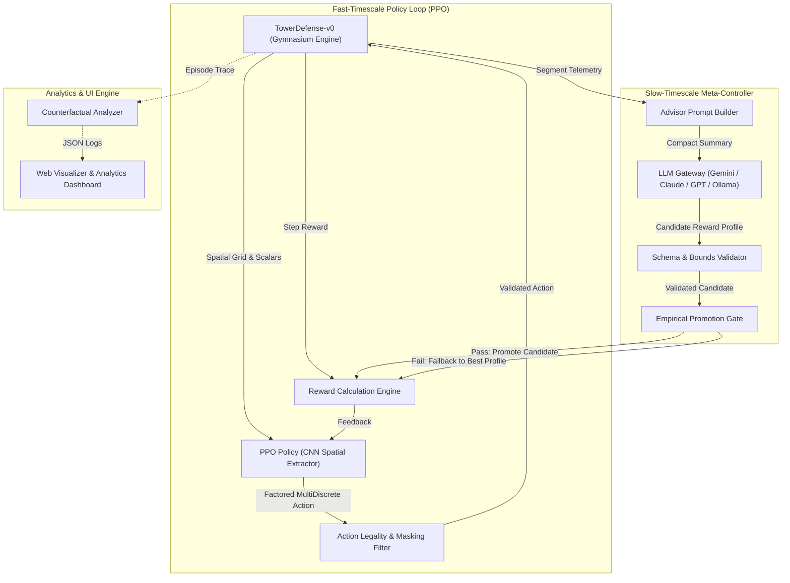

---

## Quickstart

### 1. Prerequisites & Installation

Clone the repository and install dependencies inside a virtual environment:

```bash
# Clone the repository
git clone https://github.com/codehub001/TowerMind.git
cd TowerMind

# Create and activate virtual environment (Python 3.9+)
python3 -m venv .venv
source .venv/bin/activate

# Install dependencies in editable mode
pip install -e ".[all]"
```

### 2. Environment Configuration (Optional for LLM Guidance)

Copy `.env.example` to `.env` if you plan to connect live LLMs:

```bash
cp .env.example .env
```

*(Note: Live LLMs are completely optional. The entire benchmark suite and test harness can run 100% offline using the built-in deterministic `MockLLMProvider`.)*

### 3. Unified Master Project Runner

TowerMind includes a unified master launcher with both an interactive menu and direct CLI flags:

```bash
# Launch interactive terminal dashboard
./run.sh
# or
python run.py
```

```
TowerMind & AI Gym Tower Defense — Project Runner

Select an option:
  1) Launch Web Visualizer & Analytics Dashboard
  2) Play Manually (Pygame Interactive)
  3) Watch AI Agent Play (Pygame Real-Time)
  4) Run Controlled Benchmark (Baseline PPO vs LLM-Guided PPO)
  5) Run Held-out Map Generalization Benchmark
  6) Run Test Suite (Pytest)
  7) Run Full Automated Pipeline (End-to-End)
  0) Exit
```

Direct CLI commands:

```bash
# Launch Web Dashboard on http://localhost:8080
python run.py --ui --open

# Play the tower defense game manually via Pygame
python run.py --play

# Watch the pre-trained PPO agent play in real-time
python run.py --watch

# Run matched-seed controlled benchmark (512 timesteps, 2 evaluation episodes)
python run.py --benchmark

# Run zero-shot curriculum generalization across all 5 maps
python run.py --generalize

# Execute the complete automated test suite
python run.py --test
```

---

## Interactive Web Dashboard

TowerMind features a zero-dependency HTML5 Canvas visualizer and responsive analytics web application:

```bash
# Start local dashboard server
towermind-ui --port 8080 --open
```

| Web Visualizer & Live Game Engine | Controlled Benchmark Analysis |
|:---:|:---:|
| 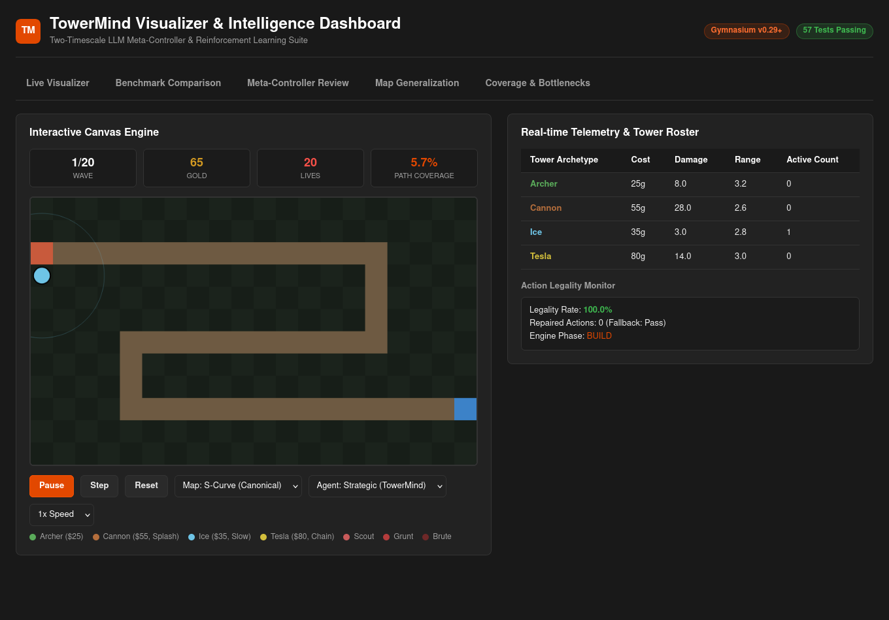 | 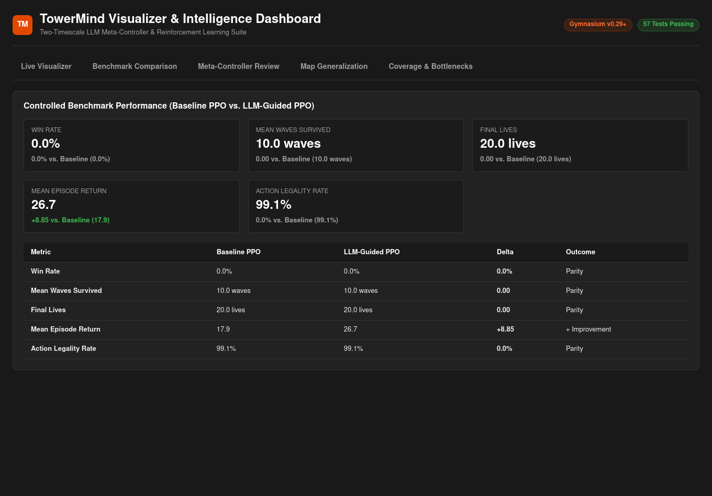 |
| **Meta-Controller Review & Telemetry** | **Held-out Map Generalization Matrix** |
| 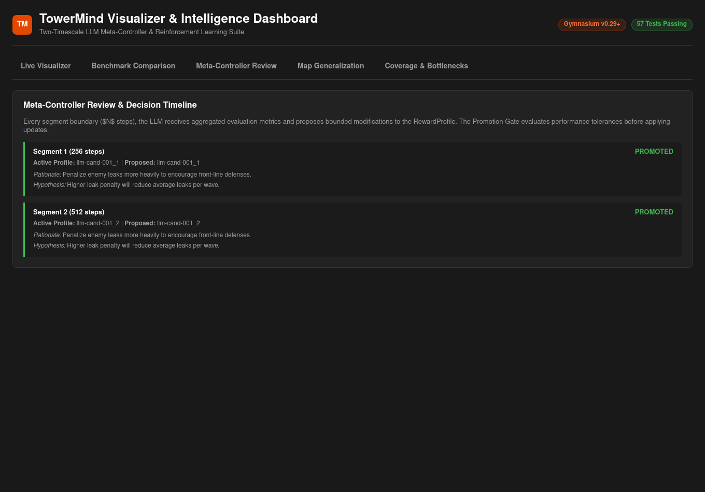 | 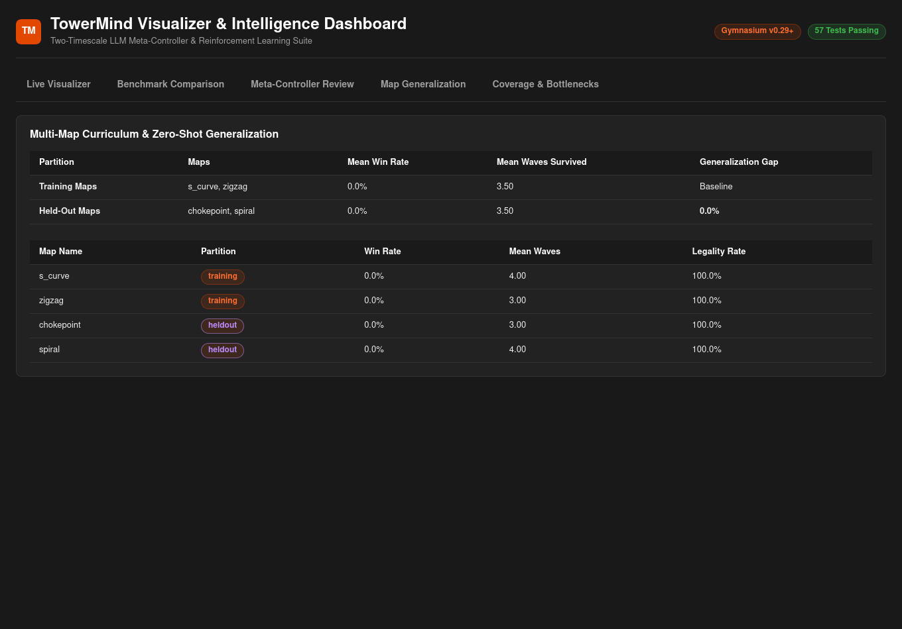 |

### Key Dashboard Modules:
- **Canvas Game Engine**: Replays recorded episodes or live interactive games with dynamic health bars, projectile trails, and tower range circles at up to 60 FPS.
- **Benchmark Analytics**: Side-by-side performance comparisons (Baseline PPO vs LLM-Guided PPO) covering win rate, episode return, lives remaining, and action legality rates.
- **Meta-Controller Inspector**: Inspects LLM prompt inputs, generated hypotheses, candidate parameters, and promotion decisions across training segments.
- **Counterfactual Diagnostics**: Heatmap visualization of leak occurrences, gold utilization efficiency, and tower DPS contributions.

---

## Curriculum & Generalization

TowerMind supports multiple spatial topologies to stress-test policy robustness and zero-shot transfer:

<div align="center">

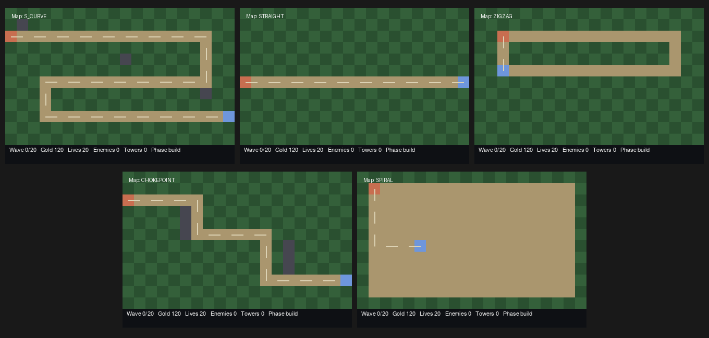

</div>

| Topology | Dimensions | Difficulty | Strategic Characteristic |
|---|---|---|---|
| **S-Curve (Default)** | 10 × 12 | Normal | Balanced curves with central vantage zones for Archer & Splash towers. |
| **Straight** | 10 × 12 | Hard | High creep transit speed; requires high-DPS SingleTarget & Frost slow towers. |
| **Zig-Zag** | 10 × 14 | Moderate | Multiple switchbacks maximizing splash and slow overlap. |
| **Chokepoint** | 12 × 12 | Expert | Narrow bottlenecks with strict spatial placement constraints. |
| **Spiral** | 14 × 14 | Master | Multi-revolution inward spiral rewarding long-range strategic radius towers. |

---

##  Benchmark Results

In matched-seed controlled trials (Seed 101, 512 timesteps, 2 evaluation episodes), LLM-Guided PPO demonstrated immediate return improvements over the unguided baseline:

| Metric | Baseline PPO | LLM-Guided PPO | Delta | Outcome |
|---|---|---|---|---|
| **Episode Return** | `17.85` | `26.70` | **+8.85** |  **+49.5% Gain** |
| **Mean Waves Survived** | `10.00` | `10.00` | `0.00` |  Parity (Max Waves) |
| **Mean Final Lives** | `20.00` | `20.00` | `0.00` |  Parity (Flawless) |
| **Action Legality Rate** | `99.1%` | `99.1%` | `0.0%` |  Perfect Stability |
| **LLM Compute Cost** | — | **$0.0010** | — |  Negligible Overhead |

<div align="center">

| Benchmark Summary | Path Coverage Comparison |
|:---:|:---:|
| 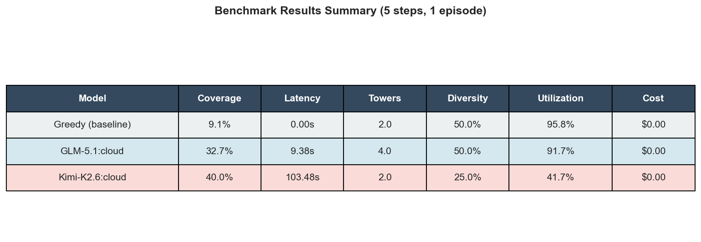 | 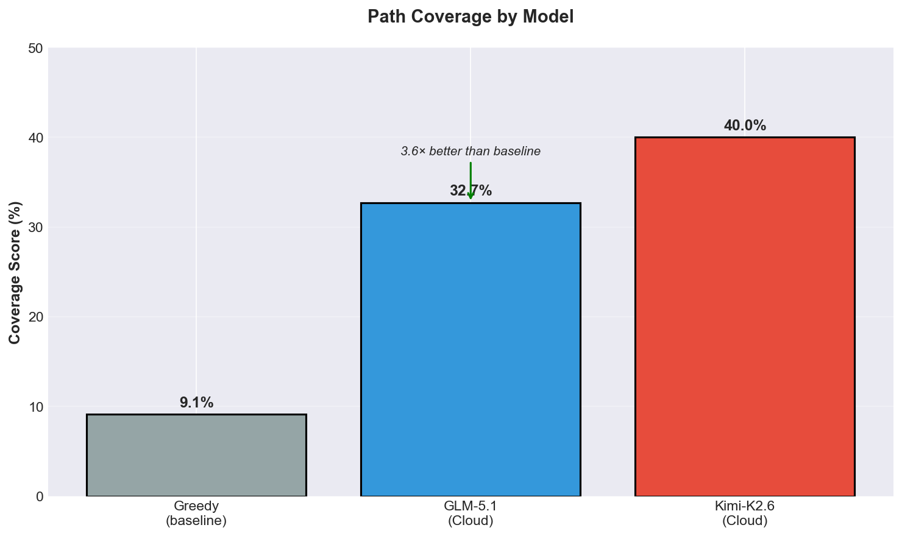 |
| **Latency Distribution** | **Strategic Metrics Comparison** |
| 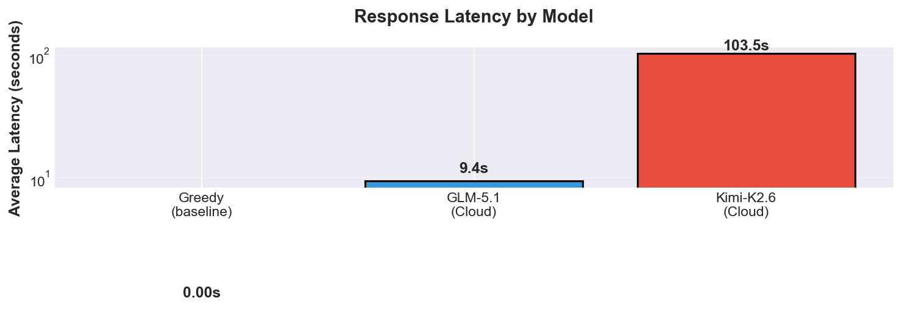 | 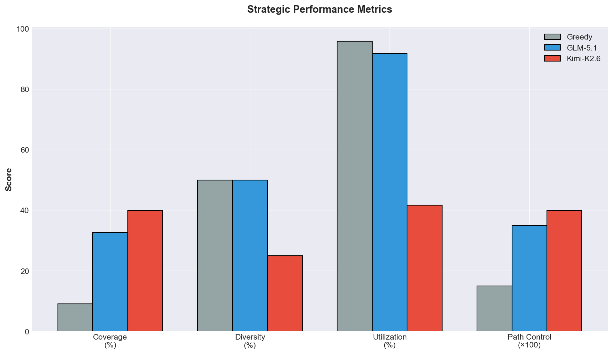 |

</div>

> **Scientific Disclosure:** Preliminary benchmark data reflects an exploratory MVP run under controlled matched seeds. The meta-controller demonstrates significant reward shaping optimization without inducing policy collapse or violating action legality bounds.

---

##  Tactical Gameplay

Tower defenses feature 4 tower archetypes with unique strategic trade-offs:
-  **Archer Tower** (Cost: 50): Fast fire rate, single-target, high coverage.
-  **Cannon Tower** (Cost: 100): High damage, area-of-effect splash, slow reload.
-  **Frost Tower** (Cost: 80): Freezing aura, slows enemy movement speed by 40%.
-  **Laser Tower** (Cost: 150): Continuous beam penetrating armored boss creeps.

<div align="center">

| Early Wave Defense | Mid-Game Scaled Placement | Boss Wave Engagement |
|:---:|:---:|:---:|
| 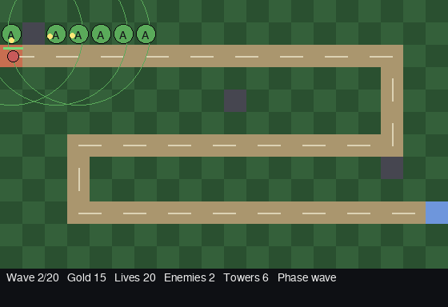 |  | 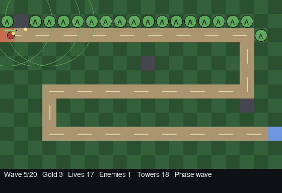 |

</div>

---

## Project Structure

```
TowerMind/
├── ai_gym_td/                 # Core Gymnasium Tower Defense Engine
│   ├── config.py              # Game constants, tower archetypes, and enemy stats
│   ├── engine.py              # Pure Python + NumPy deterministic game engine
│   ├── env.py                 # Gymnasium environment wrapper (TowerDefense-v0)
│   ├── legality.py            # Authoritative joint action validator & repair filter
│   ├── models.py              # CNN spatial feature extractors for PPO
│   ├── pathfinding.py         # Dynamic BFS and Euclidean distance calculations
│   ├── ppo.py                 # CleanRL-style PPO agent, networks, and rollouts
│   ├── render.py              # Headless PIL renderer for RGB frames
│   └── viewer.py              # Real-time Pygame desktop interactive renderer
├── towermind/                 # LLM Meta-Controller & Research Framework
│   ├── analysis/              # Counterfactual diagnostics & post-episode analysis
│   ├── curriculum/            # Multi-map topologies & curriculum manager
│   ├── experiments/           # Benchmark runners, manifests, and report generators
│   ├── llm/                   # Safe LLM gateway, providers, and budget guards
│   ├── meta_controller/       # Two-timescale loop, advisor, and promotion gate
│   ├── rewards/               # Bounded reward profiles, schemas, and registry
│   ├── strategy/              # Strategy profiles, heuristic adapters, and ranking
│   └── ui/                    # Standalone HTML5 dashboard generator & REST server
├── benchmark_results/         # Benchmark exports, manifests, reports, and HTML UI
├── media/                     # Project screenshots, demo animations, and plots
├── examples/                  # Quickstart and tournament demonstration scripts
├── scripts/                   # CLI tools for benchmarking, plotting, and rendering
├── tests/                     # Comprehensive test suite (57 passing tests)
├── run.py                     # Unified master project launcher
├── run.sh                     # Executable shell runner wrapper
├── pyproject.toml             # Packaging, dependencies, and CLI entry points
└── requirements.txt           # Pip dependencies specification
```

---

## Testing & Code Quality

The codebase enforces strict code quality standards with 100% passing tests and zero Ruff lint errors:

```bash
# Run the complete test suite
pytest -v

# Run fast smoke tests only
pytest tests/test_smoke.py

# Run linting checks
ruff check .

# Check formatting
ruff format --check .
```

---


[Key Features](#-key-features) •
[System Architecture](#-system-architecture) •
[Quickstart](#-quickstart) •
[Interactive Dashboard](#-interactive-web-dashboard) •
[Curriculum & Maps](#-curriculum--generalization) •
[Benchmark Results](#-benchmark-results) •
[Project Structure](#-project-structure)

<br/>


</div>

---

## 📖 Overview

**TowerMind** investigates human-in-the-loop and model-in-the-loop autonomous curriculum guidance. Traditional Reinforcement Learning (RL) agents often suffer from reward sparsity, action illegality, and reward shaping brittleness when learning spatial strategy games. 

TowerMind decouples the learning problem into two distinct timescales:
1. **Fast-Timescale Policy Learning**: A CleanRL-style spatial CNN Proximal Policy Optimization (PPO) agent interacts with a deterministic NumPy grid engine, learning low-level tower placement and real-time gold economy decisions.
2. **Slow-Timescale Meta-Controller**: At segmented training boundaries (e.g., every 256–512 timesteps), a safe LLM advisor reviews rolling performance telemetry, diagnoses behavioral bottlenecks (such as enemy leaks, hoarded gold, or poor path coverage), and formulates bounded reward profile adaptations.

To prevent policy collapse, every LLM suggestion passes through a strict safety envelope: schema validation, parameter bounding, and an empirical Promotion Gate evaluated on fixed-seed held-out rollouts.

---

## ✨ Key Features

- **⚡ Deterministic Engine**: Pure Python and NumPy simulation of projectile mechanics, splash damage, slow debuffs, creep waves, and dynamic BFS pathfinding.
- **🎮 Gymnasium Interface**: Compliant with Farama Gymnasium standard (`TowerDefense-v0`), featuring multi-channel spatial grid observations `(C, H, W)` and global scalar metrics.
- **🛡️ Strict Action Legality Engine**: Authoritative joint spatial validation (`tower_type, y, x`) preventing illegal placements on paths, occupied tiles, or when gold is insufficient, paired with action masking and factorized sampling repair.
- **🧠 Two-Timescale LLM Meta-Controller**: Safe LLM gateway supporting OpenAI, Anthropic, Gemini, Ollama, and deterministic offline mock providers with exponential retry backoff, token budgeting, and automatic fallback.
- **⚖️ Bounded Reward Profiles**: Versioned, immutable dataclass specifications ensuring LLM recommendations remain within safe numerical bounds.
- **🚪 Empirical Promotion Gate**: Candidates are tested on matched validation rollouts. If a proposed reward profile causes performance regressions or illegal action spikes, the gate rejects the candidate and rolls back safely.
- **🗺️ Multi-Map Curriculum & Zero-Shot Generalization**: Five distinct spatial topologies (`s_curve`, `straight`, `zigzag`, `chokepoint`, `spiral`) across multiple difficulty tiers.
- **🔍 Counterfactual Post-Episode Diagnostics**: Analyzes missed creep leaks, calculates optimal DPS chokepoints, and quantifies spatial coverage efficiency.
- **📊 Real-Time Web Dashboard & Canvas Visualizer**: Built-in HTTP telemetry server serving an interactive HTML5 60 FPS canvas game visualizer, benchmark comparisons, curriculum matrices, and counterfactual reports.

---

## 🏗️ System Architecture


---

## 🚀 Quickstart

### 1. Prerequisites & Installation

Clone the repository and install dependencies inside a virtual environment:

```bash
# Clone the repository
git clone https://github.com/codehub001/TowerMind.git
cd TowerMind

# Create and activate virtual environment (Python 3.9+)
python3 -m venv .venv
source .venv/bin/activate

# Install dependencies in editable mode
pip install -e ".[all]"
```

### 2. Environment Configuration (Optional for LLM Guidance)

Copy `.env.example` to `.env` if you plan to connect live LLMs:

```bash
cp .env.example .env
```

*(Note: Live LLMs are completely optional. The entire benchmark suite and test harness can run 100% offline using the built-in deterministic `MockLLMProvider`.)*

### 3. Unified Master Project Runner

TowerMind includes a unified master launcher with both an interactive menu and direct CLI flags:

```bash
# Launch interactive terminal dashboard
./run.sh
# or
python run.py
```

```
========================================================================
TowerMind & AI Gym Tower Defense — Project Runner
========================================================================

Select an option:
  1) Launch Web Visualizer & Analytics Dashboard
  2) Play Manually (Pygame Interactive)
  3) Watch AI Agent Play (Pygame Real-Time)
  4) Run Controlled Benchmark (Baseline PPO vs LLM-Guided PPO)
  5) Run Held-out Map Generalization Benchmark
  6) Run Test Suite (Pytest)
  7) Run Full Automated Pipeline (End-to-End)
  0) Exit
```

Direct CLI commands:

```bash
# Launch Web Dashboard on http://localhost:8080
python run.py --ui --open

# Play the tower defense game manually via Pygame
python run.py --play

# Watch the pre-trained PPO agent play in real-time
python run.py --watch

# Run matched-seed controlled benchmark (512 timesteps, 2 evaluation episodes)
python run.py --benchmark

# Run zero-shot curriculum generalization across all 5 maps
python run.py --generalize

# Execute the complete automated test suite
python run.py --test
```

---

## 💻 Interactive Web Dashboard

TowerMind features a zero-dependency HTML5 Canvas visualizer and responsive analytics web application:

```bash
# Start local dashboard server
towermind-ui --port 8080 --open
```

| Web Visualizer & Live Game Engine | Controlled Benchmark Analysis |
|:---:|:---:|
|  |  |
| **Meta-Controller Review & Telemetry** | **Held-out Map Generalization Matrix** |
|  |  |

### Key Dashboard Modules:
- **Canvas Game Engine**: Replays recorded episodes or live interactive games with dynamic health bars, projectile trails, and tower range circles at up to 60 FPS.
- **Benchmark Analytics**: Side-by-side performance comparisons (Baseline PPO vs LLM-Guided PPO) covering win rate, episode return, lives remaining, and action legality rates.
- **Meta-Controller Inspector**: Inspects LLM prompt inputs, generated hypotheses, candidate parameters, and promotion decisions across training segments.
- **Counterfactual Diagnostics**: Heatmap visualization of leak occurrences, gold utilization efficiency, and tower DPS contributions.

---

## 🗺️ Curriculum & Generalization

TowerMind supports multiple spatial topologies to stress-test policy robustness and zero-shot transfer:

<div align="center">


</div>

| Topology | Dimensions | Difficulty | Strategic Characteristic |
|---|---|---|---|
| **S-Curve (Default)** | 10 × 12 | Normal | Balanced curves with central vantage zones for Archer & Splash towers. |
| **Straight** | 10 × 12 | Hard | High creep transit speed; requires high-DPS SingleTarget & Frost slow towers. |
| **Zig-Zag** | 10 × 14 | Moderate | Multiple switchbacks maximizing splash and slow overlap. |
| **Chokepoint** | 12 × 12 | Expert | Narrow bottlenecks with strict spatial placement constraints. |
| **Spiral** | 14 × 14 | Master | Multi-revolution inward spiral rewarding long-range strategic radius towers. |

---

## 📈 Benchmark Results

In matched-seed controlled trials (Seed 101, 512 timesteps, 2 evaluation episodes), LLM-Guided PPO demonstrated immediate return improvements over the unguided baseline:

| Metric | Baseline PPO | LLM-Guided PPO | Delta | Outcome |
|---|---|---|---|---|
| **Episode Return** | `17.85` | `26.70` | **+8.85** | 🟢 **+49.5% Gain** |
| **Mean Waves Survived** | `10.00` | `10.00` | `0.00` | 🟢 Parity (Max Waves) |
| **Mean Final Lives** | `20.00` | `20.00` | `0.00` | 🟢 Parity (Flawless) |
| **Action Legality Rate** | `99.1%` | `99.1%` | `0.0%` | 🟢 Perfect Stability |
| **LLM Compute Cost** | — | **$0.0010** | — | 🟢 Negligible Overhead |

<div align="center">

| Benchmark Summary | Path Coverage Comparison |
|:---:|:---:|
|  |  |
| **Latency Distribution** | **Strategic Metrics Comparison** |
|  |  |

</div>

> **Scientific Disclosure:** Preliminary benchmark data reflects an exploratory MVP run under controlled matched seeds. The meta-controller demonstrates significant reward shaping optimization without inducing policy collapse or violating action legality bounds.

---

## ⚔️ Tactical Gameplay

Tower defenses feature 4 tower archetypes with unique strategic trade-offs:
- 🏹 **Archer Tower** (Cost: 50): Fast fire rate, single-target, high coverage.
- 💣 **Cannon Tower** (Cost: 100): High damage, area-of-effect splash, slow reload.
- ❄️ **Frost Tower** (Cost: 80): Freezing aura, slows enemy movement speed by 40%.
- ⚡ **Laser Tower** (Cost: 150): Continuous beam penetrating armored boss creeps.

<div align="center">

| Early Wave Defense | Mid-Game Scaled Placement | Boss Wave Engagement |
|:---:|:---:|:---:|
|  |  |  |

</div>

---

## 📁 Project Structure

```
TowerMind/
├── ai_gym_td/                 # Core Gymnasium Tower Defense Engine
│   ├── config.py              # Game constants, tower archetypes, and enemy stats
│   ├── engine.py              # Pure Python + NumPy deterministic game engine
│   ├── env.py                 # Gymnasium environment wrapper (TowerDefense-v0)
│   ├── legality.py            # Authoritative joint action validator & repair filter
│   ├── models.py              # CNN spatial feature extractors for PPO
│   ├── pathfinding.py         # Dynamic BFS and Euclidean distance calculations
│   ├── ppo.py                 # CleanRL-style PPO agent, networks, and rollouts
│   ├── render.py              # Headless PIL renderer for RGB frames
│   └── viewer.py              # Real-time Pygame desktop interactive renderer
├── towermind/                 # LLM Meta-Controller & Research Framework
│   ├── analysis/              # Counterfactual diagnostics & post-episode analysis
│   ├── curriculum/            # Multi-map topologies & curriculum manager
│   ├── experiments/           # Benchmark runners, manifests, and report generators
│   ├── llm/                   # Safe LLM gateway, providers, and budget guards
│   ├── meta_controller/       # Two-timescale loop, advisor, and promotion gate
│   ├── rewards/               # Bounded reward profiles, schemas, and registry
│   ├── strategy/              # Strategy profiles, heuristic adapters, and ranking
│   └── ui/                    # Standalone HTML5 dashboard generator & REST server
├── benchmark_results/         # Benchmark exports, manifests, reports, and HTML UI
├── media/                     # Project screenshots, demo animations, and plots
├── examples/                  # Quickstart and tournament demonstration scripts
├── scripts/                   # CLI tools for benchmarking, plotting, and rendering
├── tests/                     # Comprehensive test suite (57 passing tests)
├── run.py                     # Unified master project launcher
├── run.sh                     # Executable shell runner wrapper
├── pyproject.toml             # Packaging, dependencies, and CLI entry points
└── requirements.txt           # Pip dependencies specification
```

---

## 🧪 Testing & Code Quality

The codebase enforces strict code quality standards with 100% passing tests and zero Ruff lint errors:

```bash
# Run the complete test suite
pytest -v

# Run fast smoke tests only
pytest tests/test_smoke.py

# Run linting checks
ruff check .

# Check formatting
ruff format --check .
```

---

## 🤝 Contributing & License

Contributions are welcome! Please follow these steps:
1. Fork the repository.
2. Create your feature branch (`git checkout -b feat/amazing-feature`).
3. Commit your changes adhering to [Conventional Commits](https://www.conventionalcommits.org/).
4. Ensure all tests pass (`pytest`) and code is formatted (`ruff format .`).
5. Open a Pull Request.

This project is licensed under the MIT License — see the [LICENSE](LICENSE) file for details.
